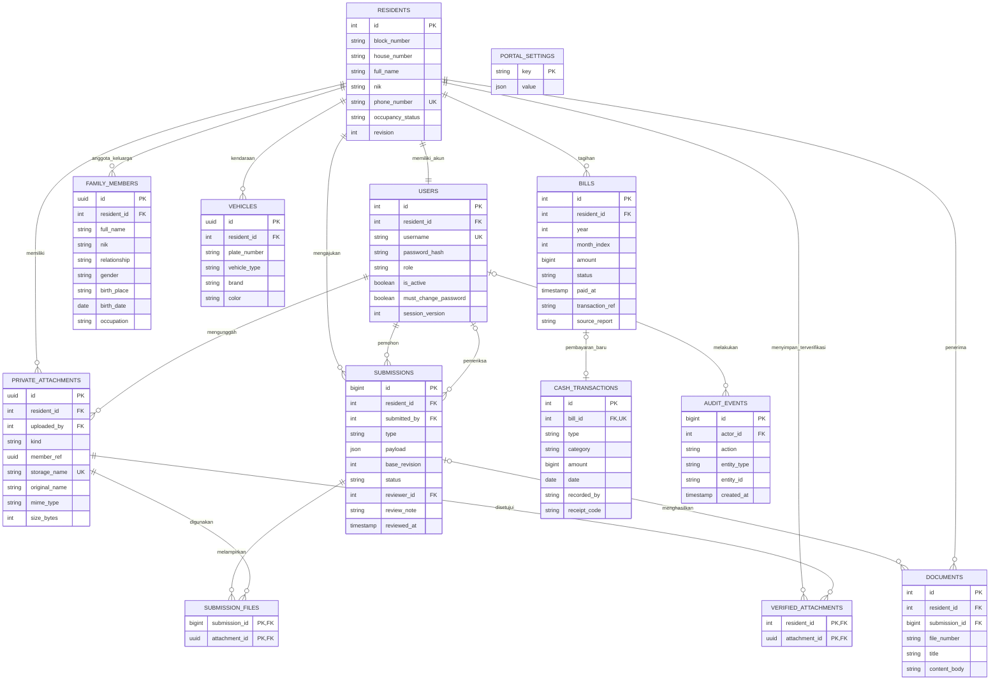
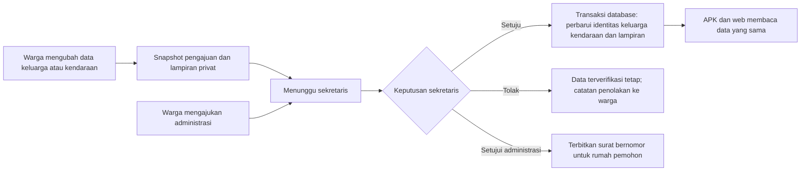
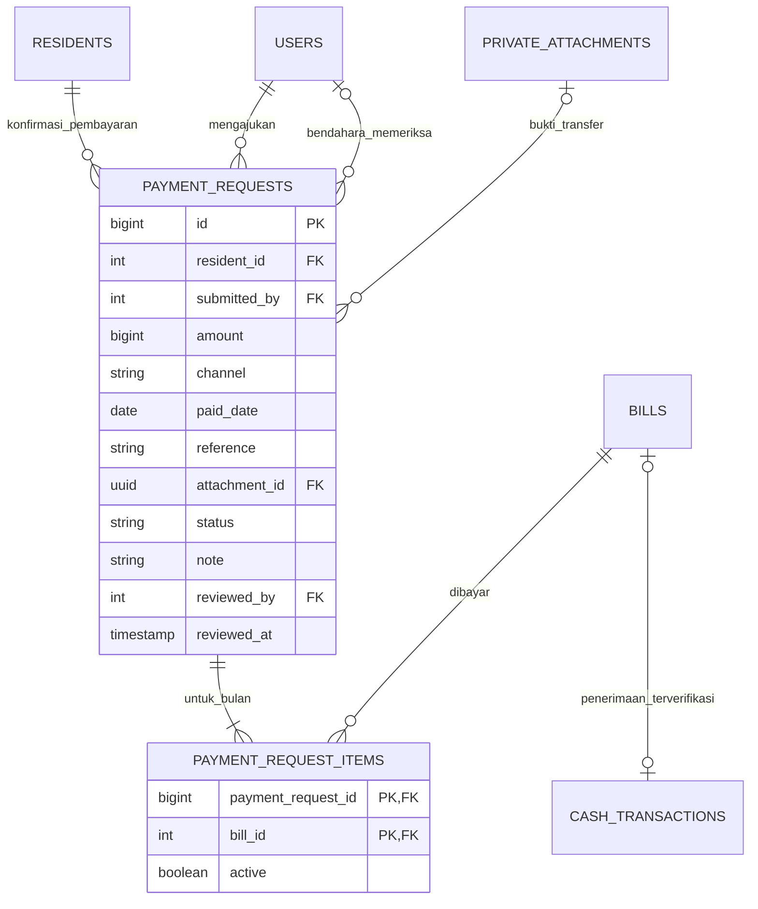

# Purimas — Model data dan hak akses

## Empat peran

| Layanan | Ketua RT | Sekretaris | Bendahara | Warga |
|---|---|---|---|---|
| Data seluruh rumah dan keluarga | Baca | Baca dan kelola | Daftar rumah dan nama kepala keluarga saja | Rumah sendiri |
| Ajukan perubahan keluarga/kendaraan/KTP/KK | Rumah sendiri melalui akun keluarga | Rumah sendiri | Rumah sendiri | Rumah sendiri |
| Verifikasi perubahan dan administrasi | Baca | Proses | — | — |
| Dokumen hasil administrasi | Seluruh dokumen | Seluruh dokumen administrasi | Milik sendiri | Milik sendiri |
| Tagihan iuran | Baca semua | — | Kelola semua | Milik sendiri |
| Debit/kredit dan saldo kas | Baca | — | Kelola | — |
| Lampiran identitas | Baca semua | Kelola berkas terverifikasi dan terkait pengajuan | Milik sendiri | Milik sendiri |
| Akun dan riwayat aktivitas | Baca | — | — | — |
| Pengumuman | Kelola | — | — | Baca |

Pengurus juga merupakan pemilik akun rumah; hak keluarga sendiri tetap berlaku. Ketua mengawasi keuangan, sedangkan hak menulis debit/kredit hanya diberikan kepada bendahara. API memeriksa akun aktif dan peran dari database pada setiap permintaan; menyembunyikan tombol bukan pengamanan utama.

## ERD

`residents` mewakili satu rumah/keluarga. `member_ref` pada unggahan adalah UUID anggota dalam snapshot pengajuan dan sengaja bukan foreign key: anggota baru belum masuk tabel terverifikasi sebelum disetujui. Kombinasi `(resident_id, year, month_index)` pada tagihan unik. `bill_id` kas unik jika terisi untuk mencegah pembayaran ganda.

## Alur verifikasi

Hanya satu perubahan data tertunda per rumah. Nomor revisi dan penguncian database mencegah snapshot lama menimpa perubahan terbaru. Pengajuan yang telah diproses tidak dapat disetujui kembali. Penambahan atau penghapusan anggota/kendaraan dilakukan lewat snapshot yang sama, bukan langsung ke data terverifikasi.

## Berkas identitas

KTP/KK hanya menerima JPG, PNG, dan PDF sampai 8 MB; isi awal berkas diperiksa. Berkas berada di volume `purimas_uploads:/app/storage`, terpisah dari direktori publik. Unduhan memerlukan otorisasi atau tiket khusus berkas dengan masa berlaku dua menit. Tiket diperiksa lagi terhadap sesi dan hak akses akun. Bendahara tidak dapat membuka KTP/KK warga lain. Nama penyimpanan berupa UUID; nama berkas pengguna tidak menjadi jalur filesystem. Cadangan operasional harus mencakup database dan volume unggahan.

## Android dan web

Android 2.1 menggunakan WebView terbatas ke origin `https://purimas.infotamadygital.com` dan menampilkan aplikasi web yang sama. Tidak ada database Room atau seed lokal yang digunakan oleh aktivitas utama. Semua pembacaan dan perubahan melalui API yang sama. Pemilihan berkas Android mendukung unggah KTP/KK. Aplikasi memerlukan koneksi Internet; perubahan tampilan web berlaku juga di Android. APK lama 1.0 harus diperbarui. APK 2.1 menambahkan layanan cetak Android.

## Pembayaran dan laporan keuangan

Warga dapat membaca saldo agregat dan pengeluaran per kategori melalui `/transparency`; hak ini tidak membuka daftar transaksi pribadi atau identitas warga lain. Perubahan kas tetap hanya oleh bendahara. KPI berasal dari tagihan dan kas tersimpan: total terbayar, belum dibayar, rasio jumlah tagihan lunas, dan konfirmasi tertunda.

Indeks unik parsial atas `payment_request_items.bill_id WHERE active` mencegah dua konfirmasi tertunda untuk tagihan yang sama. Pengajuan mengunci tagihan, menghitung nominal di server, dan memeriksa kepemilikan. Persetujuan mengunci permintaan dan tagihan, mengubah status iuran, serta menulis debit kas dalam satu transaksi. Penolakan membuka kembali tagihan untuk pengiriman ulang dan tidak mengubah saldo.

Lampiran `BUKTI` terpisah dari `KTP`/`KK`. Bendahara hanya dapat mengakses bukti yang terkait konfirmasi pembayaran; tidak mendapat akses KTP/KK rumah lain. Bukti pembayaran tidak dapat digunakan sebagai lampiran perubahan identitas.

Rekening resmi disimpan di `portal_settings.payment_account` dan hanya dapat diubah bendahara. Transfer ditawarkan setelah rekening diisi dan membutuhkan bukti; tidak ada nomor rekening atau QRIS contoh. Pembayaran tunai tetap dapat dikonfirmasi tanpa rekening bank.

Laporan memfilter tanggal pencatatan dan jenis transaksi. Saldo awal = jumlah kas sebelum awal periode; debit dan kredit = seluruh transaksi dalam periode; saldo akhir = saldo awal + debit − kredit. Filter jenis membatasi baris rincian, tidak mengubah perhitungan saldo periode. Unduhan Excel (.xlsx) menggunakan tiket singkat dengan pemeriksaan ulang peran dan sesi.

[Frontend](FRONTEND.md) · [Backend/API](BACKEND-API.md)

### Sumber data dan rekonsiliasi historis

Sumber: dua gambar laporan yang diberikan pemilik aplikasi dalam percakapan. Keduanya diperbarui 7 November 2026. Angka di bawah ditranskripsikan dari laporan, bukan data contoh. Tidak ada identitas atau tanggal bayar individual yang dibuat-buat.

### Iuran

Nominal Rp150.000 per rumah per bulan, periode Januari–Desember 2026. Tanda lunas pada laporan berurutan mulai Januari sampai bulan ke-N berikut. Pembayaran sampai Desember pada beberapa rumah merupakan pembayaran di muka menurut rekap, bukan perubahan tanggal laporan.

| Rumah | Bulan lunas | Nominal lunas | Bulan belum dibayar |
|---|---:|---:|---:|
| A1 | 12 | 1.800.000 | 0 |
| A2 | 12 | 1.800.000 | 0 |
| A3 | 8 | 1.200.000 | 4 |
| A4 | 10 | 1.500.000 | 2 |
| A5 | 6 | 900.000 | 6 |
| A6 | 10 | 1.500.000 | 2 |
| A7 | 12 | 1.800.000 | 0 |
| A8 | 11 | 1.650.000 | 1 |
| A9 | 10 | 1.500.000 | 2 |
| A10 | 10 | 1.500.000 | 2 |
| A11 | 11 | 1.650.000 | 1 |
| A12 | 10 | 1.500.000 | 2 |
| A13 | 7 | 1.050.000 | 5 |
| B1 | 10 | 1.500.000 | 2 |
| B2 | 11 | 1.650.000 | 1 |
| B3 | 12 | 1.800.000 | 0 |
| B4 | 10 | 1.500.000 | 2 |
| B5 | 12 | 1.800.000 | 0 |
| B6 | 10 | 1.500.000 | 2 |
| B7 | 11 | 1.650.000 | 1 |
| B8 | 10 | 1.500.000 | 2 |
| B9 | 10 | 1.500.000 | 2 |
| B10 | 11 | 1.650.000 | 1 |
| B11 | 8 | 1.200.000 | 4 |
| **Total** | **244** | **36.600.000** | **44** |

Total 24 rumah × 12 bulan = 288 tagihan, Rp43.200.000. Belum dibayar Rp6.600.000. Status `BELUM_BAYAR` tidak otomatis berarti sudah lewat jatuh tempo. Laporan tidak menyertakan tanggal bayar, metode, atau referensi bank individual; `paid_at` dan tanggal jatuh tempo dibiarkan kosong untuk hasil impor. Kuitansi menampilkan sumber rekap dan tidak mengarang tanggal pembayaran.

### Kas

| Masuk | Rupiah |
|---|---:|
| Saldo akhir 2025 / saldo awal 2026 | 4.163.976 |
| Iuran Purimas 2026 | 36.600.000 |
| Tunggakan 2025 diterima | 1.050.000 |
| Iuran buang sampah ranting | 1.200.000 |
| Iuran 17 Agustus | 2.300.000 |
| Lain-lain | 2.861.000 |
| **Total** | **48.174.976** |

| Keluar | Rupiah |
|---|---:|
| Keamanan | 27.500.000 |
| Sampah | 6.325.000 |
| Listrik | 2.751.503 |
| RW 03 | 1.080.000 |
| Lain-lain | 4.751.000 |
| **Total** | **42.407.503** |

**Saldo Rp5.767.473 = Rp48.174.976 − Rp42.407.503.**

Kas diimpor sebagai 11 baris rekap menurut kategori. Tanggal 7 November pada baris rekap adalah tanggal pelaporan/pencatatan, bukan klaim tanggal transaksi individual. Saldo bawaan tahun 2025 dicatat sebagai saldo awal pada 1 Januari 2026. Detail transaksi per tanggal dan bukti individual dapat ditambahkan setelah sumber tersedia, dengan rekonsiliasi agar tidak menduplikasi rekap ini.

Status iuran historis tidak menghasilkan transaksi kas baru: penerimaannya sudah termasuk rekap Rp36.600.000. Pembayaran baru yang dikonfirmasi bendahara setelah impor menambah kas tepat satu kali. Impor riwayat terpisah tidak mengubah saldo kas.

### Akun

A1–A13 dan B1–B11; tidak ada B12/B13 sesuai konfirmasi pemilik. Username `blok_a1` dan seterusnya. `blok_a8`: KETUA; `blok_b10`: SEKRETARIS; `blok_b1`: BENDAHARA; 21 akun lainnya WARGA. Password awal disepakati `purimas`, disimpan menggunakan hash bcrypt; pengguna dapat mengganti password melalui pengaturan akun.

Nama, NIK, nomor telepon, anggota keluarga, kendaraan, KTP, dan KK tidak tersedia dari laporan; field tersebut dibiarkan kosong sampai diajukan dan diverifikasi.

### Migrasi

Cadangan data demo sebelum penggantian: `/DATA/Backups/purimas/before-real-data-20261113.dump`, akses hanya pemilik file. `provisionReal.ts --replace-demo` hanya menerima dataset demo yang cocok dengan pemeriksaan eksplisit dan menolak reset setelah akun rumah sudah dibuat. `importReport2026.ts` memeriksa seluruh jumlah dan menolak impor berulang atau tabel keuangan yang sudah berisi data.

## Tambahan struktur KK dan demografi

`RESIDENTS.kk_number` menyimpan nomor KK per rumah dan `RESIDENTS.kk_address` menyimpan snapshot alamat/RT/RW/kelurahan/kecamatan/kota/provinsi/kode pos. `FAMILY_MEMBERS.kk_details` berisi atribut KK tambahan: agama, pendidikan, perkawinan, kewarganegaraan, paspor/izin tinggal, nama ayah/ibu dan golongan darah. Data ini dilindungi oleh akses profil rumah dan alur pengajuan yang sama; NIK/nomor KK dan atribut pribadi bukan bagian dari respons agregat demografi.

Satu `RESIDENTS` adalah rumah, bukan otomatis satu penduduk. Jumlah penduduk = jumlah baris `FAMILY_MEMBERS` yang terverifikasi pada rumah aktif. Kepala keluarga yang juga tercantum di bagian kepala rumah tidak ditambah lagi secara otomatis; pengguna perlu memasukkannya sebagai anggota KK. `completedHouses` menunjukkan minimal satu anggota terverifikasi, bukan kelengkapan KK.

Pilihan iuran di muka memakai nominal dalam `portal_settings`; bulan yang belum diterbitkan menjadi baris `BILLS` saat konfirmasi dibuat bersama `PAYMENT_REQUESTS` dan `PAYMENT_REQUEST_ITEMS` dalam satu transaksi. Persetujuan bendahara melunasi setiap tagihan dan mencatat kas pada tanggal pembayaran sebenarnya.

Pembayaran yang dicatat manual oleh bendahara membuat `PAYMENT_REQUESTS` berstatus DISETUJUI dan `PAYMENT_REQUEST_ITEMS` tidak aktif, sehingga tetap terlihat dalam riwayat warga tanpa menimbulkan notifikasi konfirmasi menunggu. Tagihan lunas dan transaksi kas dicatat dalam transaksi database yang sama.

Ekspor Excel sekretaris menggabungkan `RESIDENTS` dan `FAMILY_MEMBERS` menjadi satu baris per anggota keluarga yang tersimpan, termasuk metadata rumah dan alamat KK; baris rumah tanpa anggota tidak ditambahkan. Nomor identitas disimpan sebagai teks dalam Excel dan setiap unduhan dicatat pada `AUDIT_EVENTS`.

Bukti transaksi kas selain iuran: `cash_transactions.attachment_id` merupakan FK opsional ke `private_attachments.id`, unik untuk nilai non-null. `private_attachments.kind=KAS` membedakan bukti JPG/PDF kas dari KTP, KK dan BUKTI pembayaran warga. Berkas diunggah Bendahara dan hanya dibuka Ketua/Bendahara. `receipt_code` historis dipertahankan.
